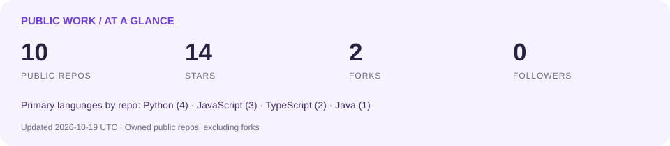

<p align="center">
  
  <a href="https://github.com/Crazy4Lamb?tab=repositories"></a>
  
</p>

## 你好，我是 Crazy4Lamb / Hi, I'm Crazy4Lamb 👋

保持好奇，把想法写成代码，把学习变成可以体验的小作品。喜欢实用的工具，也喜欢有趣的实验；不限定题材，边学边做，持续迭代。

Curious by default. I turn ideas into code and learning into things you can try. I enjoy useful tools and playful experiments, exploring new directions through small projects and continuous iteration.

正在制作 [墨读 DeepRead](https://github.com/Crazy4Lamb/deepread)：把电子书放进熟悉的 AI 聊天界面，探索本地优先的阅读体验与可选的真实模型对话。

Currently building [DeepRead](https://github.com/Crazy4Lamb/deepread), a local-first ebook reader inside familiar AI chat interfaces, with optional live model conversations.

📍 Shanghai, China · 🌱 Learning in public · 🛠️ Building as I learn

## 最近发布 / Latest Project

<!-- LATEST:START -->
### 🚀 [deepread](https://github.com/Crazy4Lamb/deepread)

墨读：聊天界面中的本地电子书阅读器，可选接入 AI 模型 / Local ebook reader in AI chat interfaces with optional live model chat.

`HTML`
<!-- LATEST:END -->

## 最近在学 / Currently Learning

- **AI 与大模型 / AI & LLMs** — 理解模型能力、提示设计与实际应用。Exploring model capabilities, prompting and practical applications.
- **Agent / 智能体** — 学习工具调用、上下文管理、任务流程与技能组织。Learning tool use, context management, workflows and reusable skills.
- **从实验到作品 / Experiments → Projects** — 用小项目验证想法，记录问题与改进。Testing ideas through small projects and documenting what I learn.

```text
Curiosity → Learn → Build → Try → Improve → Repeat
好奇心       学习     动手     体验    改进      继续探索
```

## 作品实验室 / Project Lab

这里的作品是探索记录。列表根据本人拥有的公开仓库自动生成，新的项目会随主页任务加入。

These projects are snapshots of what I'm exploring. The list is generated from my owned public repositories, so new projects join it automatically.

<!-- PROJECTS:START -->
| Project / 项目 | Description / 简介 | Stack / 技术 |
|---|---|---|
| [deepread](https://github.com/Crazy4Lamb/deepread) | 墨读：聊天界面中的本地电子书阅读器，可选接入 AI 模型 / Local ebook reader in AI chat interfaces with optional live model chat. | HTML |
| [crm-bi](https://github.com/Crazy4Lamb/crm-bi) | CRM BI: a Spring Boot and PostgreSQL 18 platform for customer operations, sales workflows, and business intelligence. | JavaScript · business-intelligence · crm · dashboard |
| [kg-quiz](https://github.com/Crazy4Lamb/kg-quiz) | 数学知识图谱教学与自适应练习平台 / Mathematics knowledge graph teaching platform with adaptive quizzes, question bank and learning analytics. | Java |
| [office-game](https://github.com/Crazy4Lamb/office-game) | 工作组游戏：团队沟通与办公室策略对战 / Office Game: multiplayer team communication and office strategy game with solo practice and optional AI interaction. | JavaScript |
| [quarrel-trainer](https://github.com/Crazy4Lamb/quarrel-trainer) | 吵架练习器：沟通与个人边界表达练习 / Quarrel Trainer: practice assertive communication, conflict responses and personal boundaries with optional AI coaching. | JavaScript |
| [uknowder.skill](https://github.com/Crazy4Lamb/uknowder.skill) | 你知道个der：反说教、反PUA与个人边界表达 / Push back on patronizing talk with rebellious, sarcastic and boundary modes, Python CLI and agent skill. | Python · ai · skill · skills |
| [iknowder.skill](https://github.com/Crazy4Lamb/iknowder.skill) | 我知道个der：佛系退场、摆烂敷衍与不装懂回应 / Humorous opt-out responses with relaxed, slacker and deadpan modes, Python CLI and agent skill. | Python · ai · iknowder · skill |
| [diewei.skill](https://github.com/Crazy4Lamb/diewei.skill) | 爹味说教生成器：长辈口吻、打压式关怀与人生道理讽刺 / Patronizing lecture generator with configurable styles, local Python CLI and agent skill. | Python · ai · diewei · shittalk |
| [wayfinder](https://github.com/Crazy4Lamb/wayfinder) | wayfinder | TypeScript |
| [ai_website](https://github.com/Crazy4Lamb/ai_website) | An ongoing experiment / 持续探索中 | TypeScript |
<!-- PROJECTS:END -->

[查看全部项目 / Explore all repositories →](https://github.com/Crazy4Lamb?tab=repositories)

## 最近更新 / Recently Updated

<!-- RECENT:START -->
| Project | Description / 简介 | Updated (UTC) |
|---|---|---|
| [deepread](https://github.com/Crazy4Lamb/deepread) | 墨读：聊天界面中的本地电子书阅读器，可选接入 AI 模型 / Local ebook reader in AI chat interfaces with optional live model chat. | 2026-10-22 |
| [crm-bi](https://github.com/Crazy4Lamb/crm-bi) | CRM BI: a Spring Boot and PostgreSQL 18 platform for customer operations, sales workflows, and business intelligence. | 2026-10-15 |
| [kg-quiz](https://github.com/Crazy4Lamb/kg-quiz) | 数学知识图谱教学与自适应练习平台 / Mathematics knowledge graph teaching platform with adaptive quizzes, question bank and learning analytics. | 2026-10-15 |
| [office-game](https://github.com/Crazy4Lamb/office-game) | 工作组游戏：团队沟通与办公室策略对战 / Office Game: multiplayer team communication and office strategy game with solo practice and optional AI interaction. | 2026-10-13 |
| [quarrel-trainer](https://github.com/Crazy4Lamb/quarrel-trainer) | 吵架练习器：沟通与个人边界表达练习 / Quarrel Trainer: practice assertive communication, conflict responses and personal boundaries with optional AI coaching. | 2026-10-13 |
| [uknowder.skill](https://github.com/Crazy4Lamb/uknowder.skill) | 你知道个der：反说教、反PUA与个人边界表达 / Push back on patronizing talk with rebellious, sarcastic and boundary modes, Python CLI and agent skill. | 2026-10-12 |
<!-- RECENT:END -->

最近更新列表根据公开仓库自动生成，新的公开项目也会加入。 / Automatically refreshed from public repositories, including new projects.

## GitHub 小仪表盘 / GitHub Snapshot



仓库、Star、Fork 统计仅包含本人拥有的公开非 Fork 仓库；主语言按仓库数量统计，不代表技能熟练度。统计卡和最近更新每天刷新。

Repository, star and fork totals cover owned public repositories excluding forks. Languages reflect repository primary-language counts, not proficiency. The snapshot and recent list refresh daily.

访客徽章由 [Komarev](https://github.com/antonkomarev/github-profile-views-counter) 提供，记录启用后的页面访问计数，不是独立访客人数，也不回溯历史访问。

The visitor badge counts page hits since activation, not unique people or historical visits. It is provided by Komarev and may be affected by caching.

## 交流 / Say Hello

欢迎交流 AI、Agent 和有趣的项目想法。发现问题、想到改进，欢迎在对应仓库提 Issue 或 Pull Request。

Happy to exchange ideas about AI, agents and interesting projects. Feedback, issues and pull requests are welcome in the relevant repository.

<sub>Still learning. Still building. Still curious. / 持续学习，持续动手，持续好奇。</sub>
